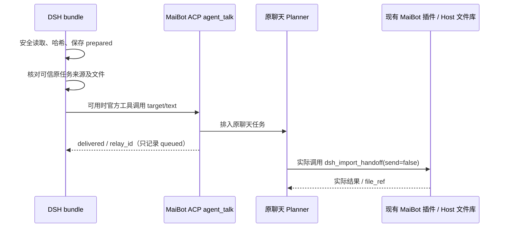

# DSH → MaiBot 文件产物交接

这是符合官方 Cordis 生命周期与工具 API 的 TypeScript **DSH bundle**，与 [maibot-dsh-artifacts v0.2.0](https://github.com/MemoryController/maibot-dsh-artifacts/tree/ba8a5fb4dc9857982f9cf5518b746ed0f9c282c8) 配合。它准备可验证的 manifest，满足可信来源条件时尝试传话；文件入库仍由原聊天的 MaiBot 插件在 Host 签发的文件作用域内完成。

**当前标准 ACP 未提供结构化可信原聊天目标。因此开箱默认是 `needs_target`，不会自行解析提示词中的“回复目标”。** 自动通知需要部署者提供下述可信进程内适配器；仅有普通 ACP 连接无法启用该能力。

## 适配与验证范围

| 组件 | 固定依据 / 范围 |
| --- | --- |
| Linux / Node.js | Linux `/proc/self/fd`，Node ≥24；当前执行版本 24.19.0 |
| DSH | 精确 `0.2.2-alpha.2`；源码 `ce7073d51254c26cd63b22a60835b8f948deb447` |
| Cordis | `@deepseek-ai/cordis@4.0.6-alpha.1` |
| MaiBot 插件 | v0.2.0，`ba8a5fb4dc9857982f9cf5518b746ed0f9c282c8`；调查时远端无更新差异 |
| MaiBot / SDK | v1.3.18 / v2.19.0，依据对端兼容文档与固定官方源码；未在此环境运行 Host |

已验证真实官方 Cordis、Native/PTC 执行器、MCP bridge 的隔离测试，以及固定对端 Python 验证器。真实 MaiBot ACP 网络传输、原聊天 Planner 选工具、Docker/QQ 文件入库及发送**尚未联调**。详细源码证据见 [官方接口审计](docs/upstream-audit.md)，执行记录见 [验证记录](docs/validation.md)。

DSH npm 的 `latest` 标签可能落后；不要将本包的精确 alpha 依赖替换为 latest 后假设兼容。

## 安装

已有精确 DSH CLI、pnpm 和普通用户可写的 profile 目录时，使用官方命令：

```sh
# 尚未安装 CLI 时，可在用户管理的 Node 环境中安装：
npm install --prefix "$HOME/.local/dsh-artifacts-cli" --ignore-scripts @deepseek-ai/dsh@0.2.2-alpha.2
export PATH="$HOME/.local/dsh-artifacts-cli/node_modules/.bin:$PATH"

# 以下为已验证的实现提交；部署前请审核该提交。
dsh plugin --profile maibot add 'github:MemoryController/dsh-maibot-artifacts#f23f5d93ad52279eddf5f289a476e6d6dcbccf74' --ignore-scripts
dsh --profile maibot --dump-config
```

本仓库提交预构建 `dist/*.js` 和声明文件，不提供 `prepare/install/postinstall` 钩子，不要求 allowBuilds。GitHub 安装仍会下载并在运行时执行插件代码；应审核并固定 SHA。CI 对预构建产物作独立重建逐字节比对，防止源码和提交产物漂移。

已实际验证上述 GitHub 固定提交通过官方 profile 安装、启动并注册三个工具。pnpm 11 可能提示 git 包构建脚本被忽略；本包保留供开发者使用的 build 脚本，但安装不需要执行它，已有 dist 会被直接加载。主机提供的 DSH peer 包必须与精确版本一致。

也可从审核后的 checkout 安装预构建包：

```sh
npm ci --ignore-scripts
npm run check
npm pack --ignore-scripts
dsh plugin --profile maibot add ./dsh-maibot-artifacts-0.1.0.tgz --ignore-scripts
```

未发布 npm 包或 Release；以上 GitHub 命令需要该提交已经推送。

## 配置与工作目录

在 `$DSH_HOME/profiles/maibot/cordis.patch.yml` 添加覆盖层。DSH 覆盖整个 config，以下列出完整配置：

```yaml
- id: maibot-artifacts
  config:
    workspaceRoot: /srv/maibot-agent
    stateDir: /srv/dsh-maibot-artifacts-state
    maxFileBytes: 52428800
    maxBatchFiles: 8
    notificationTimeoutMs: 30000
```

两个路径均须是规范绝对路径、无软链接；`stateDir` 必须在共享根之外、归 DSH 用户所有且权限为 0700。可换成用户已拥有的目录，无需 root。预先准备真实 `outbox`/`inbox`，不要用软链接代替挂载点。默认每文件 50 MiB、每批 8 个；两端同时配置后可提高至 **1 GiB / 32 个**，本包拒绝超过对端实现上限的配置。通知超时范围 1–300000 ms。

首次操作会创建私有状态目录；已有宽权限目录会被拒绝而非自动修改。保留该目录及备份；删除、回滚或丢失它会丢失去重证据，不能据空目录认为旧操作未执行。不同实例使用同一状态目录需有相同可信 UID 和本地支持原子 link/rename/fsync 的文件系统；不承诺 NFS 或故障磁盘语义。

## 连接现有 MaiBot ACP

继续使用部署中已有的 MaiBot → DSH ACP 启动/SSH 配置，无需新增 HTTP 服务。官方 MaiBot v1.3.18 在 ACP `session/new` 中向 DSH 提供 `maibot-agent` MCP server；DSH 将其挂到相应 Agent scope，标准可见工具为：

```text
mcp__maibot-agent__agent_talk({target: "原任务真实回复目标", text: "..."})
```

不要硬编码连接 URL、伪造 session_id、用其他聊天目标试探或把私有 ACP MCP 端口暴露出去。既有 MCP 配置若使用了其他合法 serverName，可信适配器须提供实际注册名称。检查原 Agent 的工具列表和部署日志，不用管理员 API 枚举聊天。

**Native 与 PTC 不同**：本包通过 `ctx.tools.execute` 调用并保留 agent、toolSet、signal、guard。Native 能程序化执行该 MCP 工具；官方 PTC 拒绝这种原生工具 root batch，返回 `prepared_only`。本包不会绕过策略直接调用 tool definition。可由原任务持有者在现有 PTC `run_code`/MCP 工具界面人工传入原始目标和返回的 `relay_text`；不要更改 task_id。人工操作不自动更新本地通知证据，需保留原始回执。

### 可选可信目标适配器（本项目扩展）

官方 DSH 没有 `maibotArtifactTarget` 服务；本包声明它作为**部署者自行提供的可信进程内接口**，不声称标准 ACP 会安装它。纯提示词、模型参数、清单、文件内容或 `agent_chats` 结果都不能作为此适配器的来源。

可信 Host 连接代码只有在真正持有原任务来源时，才能提供 `TrustedTargetBindings`：

```ts
import { TrustedTargetBindings } from 'dsh-maibot-artifacts'
const bindings = new TrustedTargetBindings()
ctx.provide('maibotArtifactTarget', bindings)
// 下列值必须由真实 Host 任务及调度器取得；不是从模型文本提取。
const unbind = bindings.bind(actualAgent, actualRootCallId, {
  originId: authenticatedOriginalTaskId,
  target: originalHostReplyTarget,
  toolName: 'mcp__maibot-agent__agent_talk',
})
// 对应调用结束时 unbind()；适配器卸载时 bindings.dispose()。
```

匹配实际 Agent 对象和执行 rootCallId；prepare 与 publish 通常是不同 root call，Host 必须分别绑定，且使用**同一**可信 originId、target、toolName。本包在 prepare 时保存三者的哈希，publish 不匹配即拒绝。准备时没有绑定的任务始终保持人工交接模式，不能用后来的目标接管。绑定服务不是模型工具，也不签发 MaiBot 文件权限。没有这种可信 Host 集成的部署请使用默认人工路径，不要构造假的任务上下文。

## 工具与清单

1. 将完成写入且关闭写句柄的文件放入共享工作区独立任务目录；不要覆盖旧产物。
2. 调用 `maibot_artifact_prepare({"paths":["outbox/task-001/结果.png"]})`。
3. 保留返回的 `manifest.task_id`；调用 `maibot_artifact_publish({"task_id":"返回的32位ID"})`。
4. 用 `maibot_artifact_local_status({"task_id":"同一个ID"})` 只读检查本地记录。

```json
{
  "type": "dsh_artifacts",
  "version": 1,
  "task_id": "0123456789abcdef0123456789abcdef",
  "files": [{
    "path": "outbox/task-001/结果.png",
    "size": 1234,
    "sha256": "0123456789abcdef0123456789abcdef0123456789abcdef0123456789abcdef"
  }]
}
```

示意大小与哈希不能照抄。实际清单由文件计算，严格只有上述字段；聊天 ID、target、send 均不进入 manifest。工具不接受模型提供的 task_id 来创建新任务；ID 使用密码学随机 16 字节。相同 Agent、同一可信来源（或同为未绑定）、相同路径和内容的重复准备复用任务记录；顺序变化不创建新任务。不同来源有独立记录。

传话文本要求原聊天实际调用 `dsh_import_handoff(manifest=..., send=false)` 并报告真实 `file_ref`。此文本不会强制 Planner 选工具，也不是发送授权。DSH 不能经 ACP 调用对端第三方插件工具。



## 回执与故障

| 本地字段 / 结果 | 确切含义 | 后续 |
| --- | --- | --- |
| state=`prepared` | 文件清单已准备 | 无上传/通知证明 |
| result=`needs_target` | 缺少原始可信来源或与 prepare 不匹配 | 原任务持有者人工核实后交接，不从文件猜目标 |
| result=`prepared_only` | 该调用没有派发通知（如 MCP 未安装、guard 拒绝、PTC、文件变化） | 保留 ID 和原因；人工排障，本包不自动补发 |
| state=`queued` | 精确收到匹配 target 的 delivered=true、合法 relay_id | 仍需原聊天调用插件并报告真实 file_ref |
| state=`unknown` | 超时、取消、异常、回执不完整或崩溃窗口 | **禁止自动重发或换 ID 重做**；核查原聊天及原调用回执 |

本地永远没有 `imported`/`sent` 状态。即使 payload 声称 imported，本包也仅接受固定格式的排队证据。状态查询不触发 MCP，不查询其他聊天文件库。原聊天才可通过 `dsh_handoff_status` / `files_list` 在合法作用域内核查。没有 file_ref 不声称入库；文件入库不等于 QQ 已发送。

通知前持久化永久 `.attempt` 栅栏；即便已知未派发，该任务也不会自动尝试第二次。并发调用和进程重启复用记录；崩溃后不完整尝试显示 unknown。超时返回后远端仍可能执行，迟到回执不会把 unknown 擅自升级为成功。可信部署不能为非幂等 `agent_talk` 配置盲目重试中间件。

默认路径不调用任何远端工具。人工路径中的 `relay_text` 只是参数准备，不表示通知完成；本地账本也不自动跟踪人工操作。

## Docker MaiBot + Linux 宿主机 DSH

在现有 Compose 服务中由部署者配置共享目录（片段）：

```yaml
services:
  maibot:
    volumes:
      - ./maibot-dsh-artifacts:/app/MaiBot/plugins/maibot-dsh-artifacts
      - /srv/maibot-agent:/srv/maibot-agent
      # 保留原有 MaiBot data 持久卷，不挂给 DSH。
```

DSH 使用普通用户运行；共享 `inbox/outbox` 给予 DSH 和真实 Runner 所需的 UID/GID/共享组权限，避免 chmod 777。DSH 私有 `stateDir` 不挂给容器。MaiBot 启用官方 files 能力并授权已有插件所需 files.list/upload/download/send；对端配置的 shared_root 和大小/批量限制与本包保持一致。镜像路径、SDK 实际 Runner 环境、既有 ACP/SSH 和文件传输后端按已部署实例确认。详见对端 [Docker 文档](https://github.com/MemoryController/maibot-dsh-artifacts/blob/ba8a5fb4dc9857982f9cf5518b746ed0f9c282c8/docs/docker.md)。插件不需要 root、Docker Socket、管理员 Token 或新增特权服务。

## 安全边界与开发

文件访问使用 Linux 描述符锚定逐级打开和 `O_NOFOLLOW`；拒绝路径穿越、绝对路径、软链接、硬链接、目录、FIFO 及特殊文件。检查实际读取字节数、dev/ino/size/mtimeNs/ctimeNs/nlink 和读取后的路径关系。prepare 与 publish 前分别校验；最终由 MaiBot 再次验证清单大小/哈希。

**这不是不可变快照或跨主机原子事务**：检查之后文件仍可能变化，进程不能隔离相同 UID、可移动祖先目录/挂载的主体。共享根与祖先目录、挂载、同 UID 进程及已安装 Host 插件必须可信；发布者必须停止写入。文件内容不执行、不解包、不进入提示词、不作为指令或发送许可。

本地记录按真实 DSH Agent ID 隔离，包含路径、哈希、通知原因及目标/来源哈希；不宣称是 MaiBot 聊天级权限边界。同一 Agent 的自动通知还必须匹配准备时的原始 Host 来源。任务 ID 不是聊天授权。stateDir 的可信权限和持久保存是保证的一部分。

```sh
npm ci --ignore-scripts
npm run typecheck
npm run lint
npm test
npm run build
npm run verify:dist
npm run test:install
npm run test:profile
# 对端只读 checkout 需固定在协议基准：
node scripts/verify-protocol.mjs /path/to/maibot-dsh-artifacts
```

修改源码后须重建并提交 dist，CI 的 verify:dist 会拒绝旧产物。测试使用真实官方运行时与模拟 MCP 回调，不调用管理员接口、外部聊天或 QQ。MIT 许可。
